# Práctica PR0302: Scripts en Bash

**Alumno:** Pablo González Coto

## 1 y 2. Fecha y hora del sistema
Script que muestra la fecha y hora del sistema, incluyendo una versión formateada con un mensaje personalizado utilizando el comando `date`.
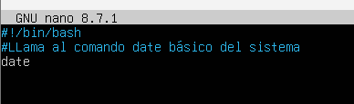
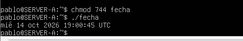

## 3. Suma de dos números
Script que solicita al usuario dos números por teclado y muestra el resultado de su suma evaluando la expresión aritmética.
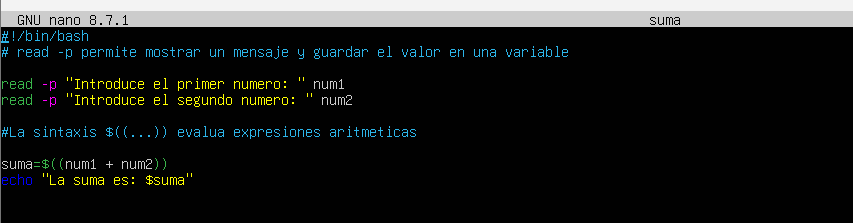
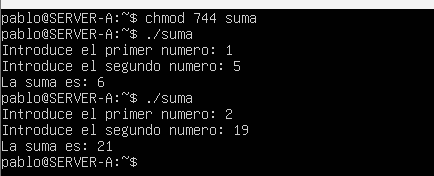

## 4. Número par o impar
Script que determina si un número introducido por el usuario es par o impar utilizando el operador módulo (`%`).
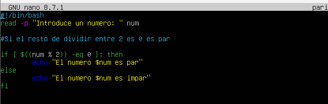
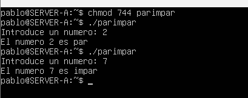

## 5. Contar líneas de un archivo
Script que solicita la ruta o nombre de un archivo, verifica que existe y es un archivo regular, y cuenta cuántas líneas tiene utilizando `wc -l`.
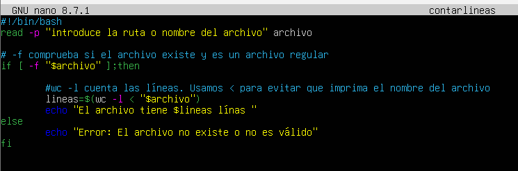
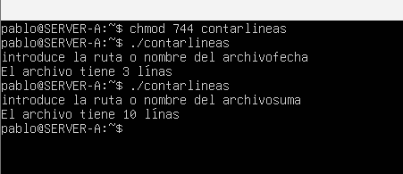

## 6. Tabla de multiplicar
Script que imprime la tabla de multiplicar de un número introducido por el usuario mediante un bucle `for` del 1 al 10.
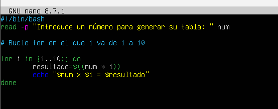
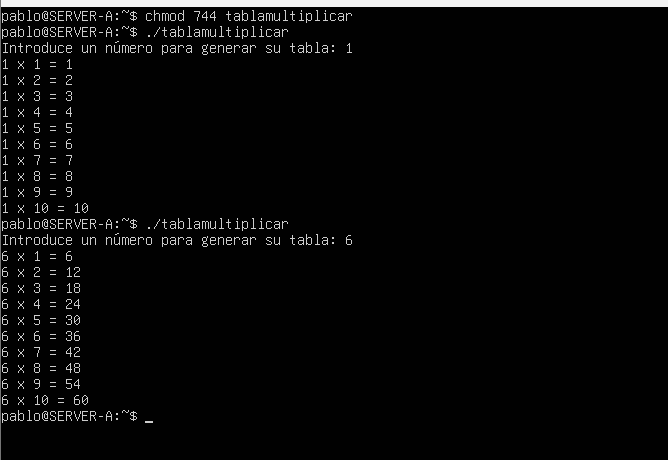

## 7. Comprobar permisos
Script que solicita el nombre de un archivo e informa detalladamente si tiene permisos de lectura (`-r`), escritura (`-w`) y ejecución (`-x`) para el usuario actual.
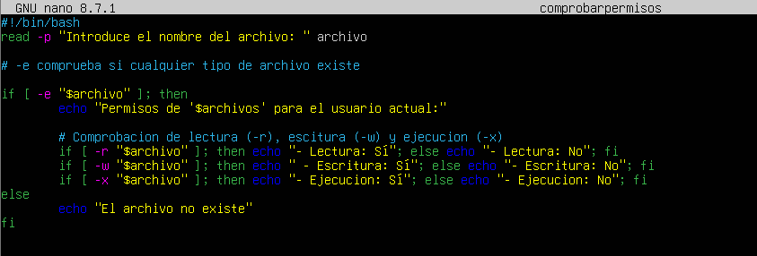
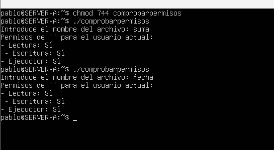

## 8. Copiar por extensión
Script que crea un directorio de destino (si no existe) y copia todos los archivos con una extensión específica desde un directorio de origen ocultando los errores estándar.
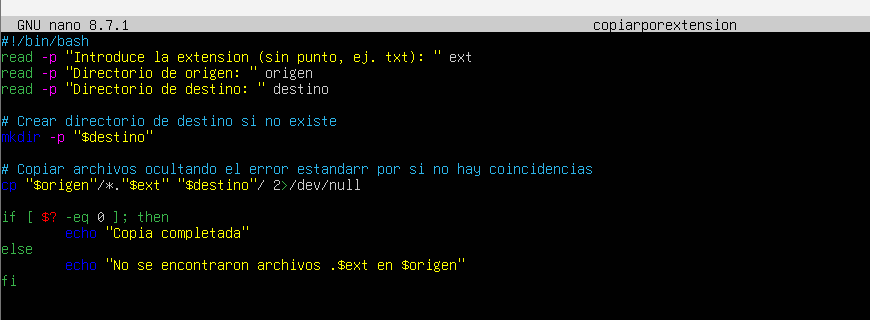
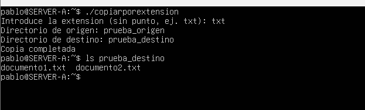

## 9. Contar palabras
Script que verifica la existencia de un archivo y cuenta cuántas palabras contiene en total utilizando el comando `wc -w`.
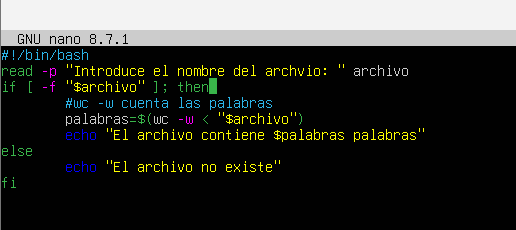
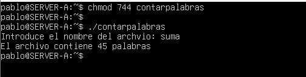

## 10. Copia de seguridad
Script que comprime todos los ficheros del directorio Escritorio en un archivo llamado `backup.DDMM.gz` (donde DD es el día y MM el mes actual) utilizando el comando `tar`.
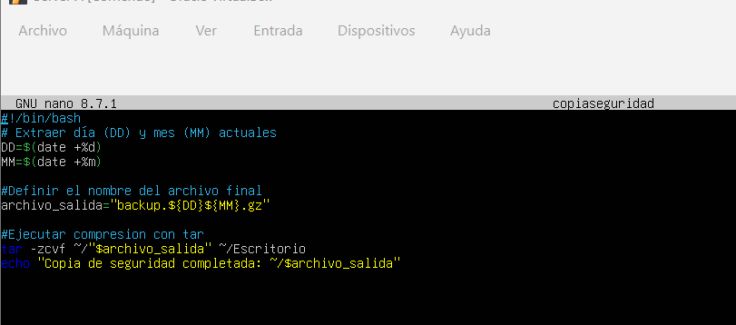
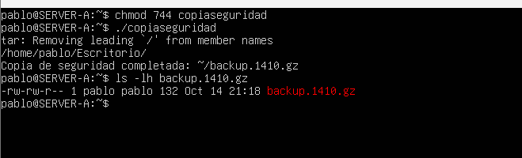