# Práctica PR0302: Scripts en Bash

**Alumno:** Pablo González Coto

## 1. Contar líneas de un archivo
Script que solicita la ruta de un archivo, verifica que realmente existe mediante un condicional y, de ser así, cuenta e imprime su número de líneas.

## 2. Verificación de un archivo
Script que comprueba dos condiciones sobre la ruta indicada por el usuario: si el archivo existe en el sistema y si el usuario actual tiene permisos de lectura sobre el mismo.

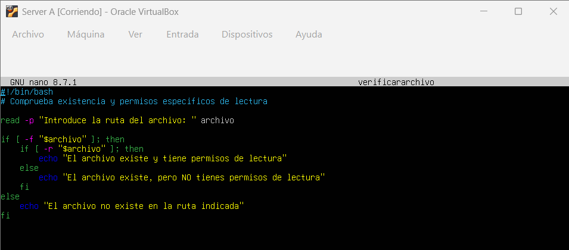
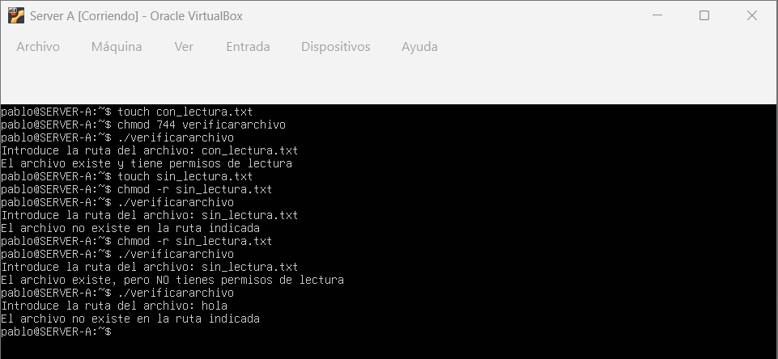

## 3. Comparación de números
Script que pide dos valores numéricos por teclado y los compara para determinar e imprimir por pantalla cuál es el mayor, o si ambos son exactamente iguales.

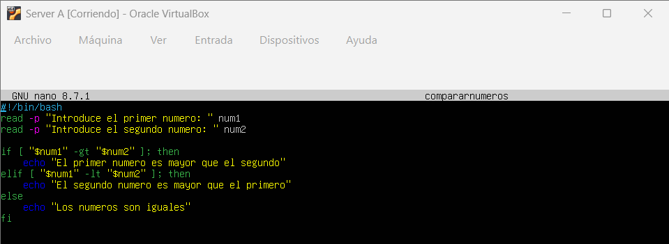
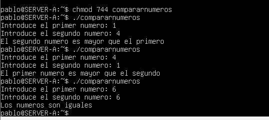

## 4. Validación de contraseña
Script de autenticación básica que pide una clave ocultando la escritura en la terminal (usando `read -s`) y la compara con una contraseña predefinida internamente en el código.

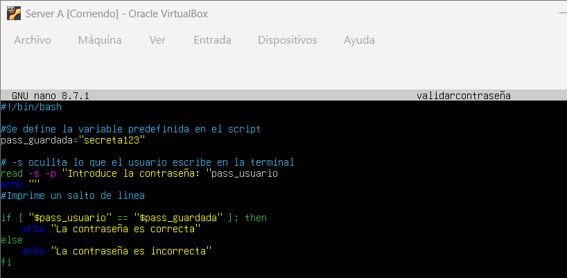
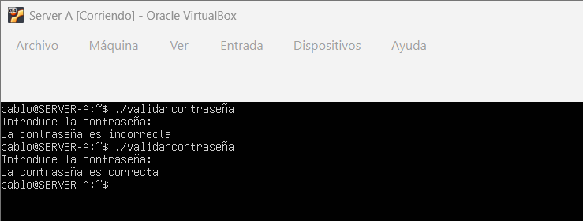

## 5. Comprobación de directorio
Script que evalúa si un directorio existe y tiene permisos de escritura. Incluye una función de autocreación que genera el directorio automáticamente en caso de que no exista.

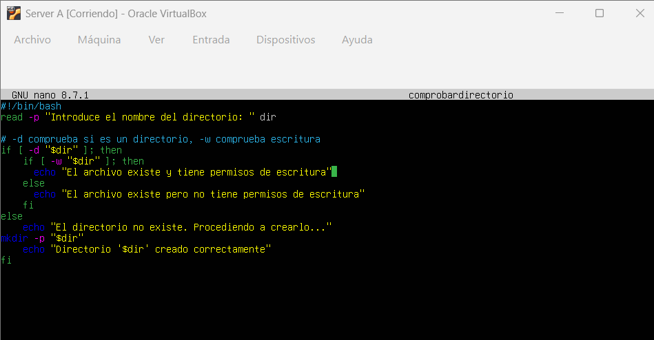
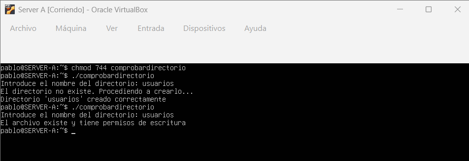

## 6. Verificar si el usuario es root
Script de comprobación de privilegios que utiliza el comando `id -u` para detectar si el código se está ejecutando con el usuario administrador (root) o como un usuario normal.

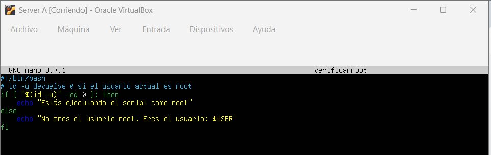
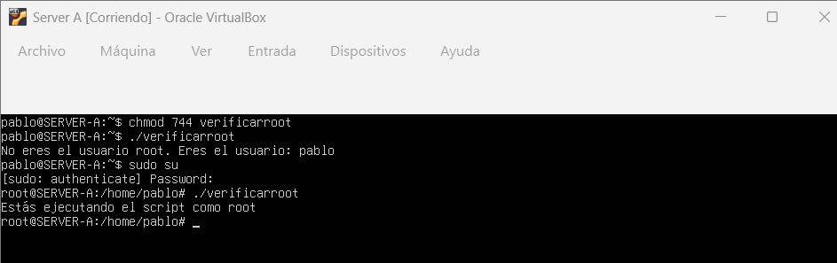

## 7. Calificación de un examen
Script evaluador numérico que determina si una nota introducida es igual o superior a 5 para imprimir "Aprobado", o menor para imprimir "Suspenso".

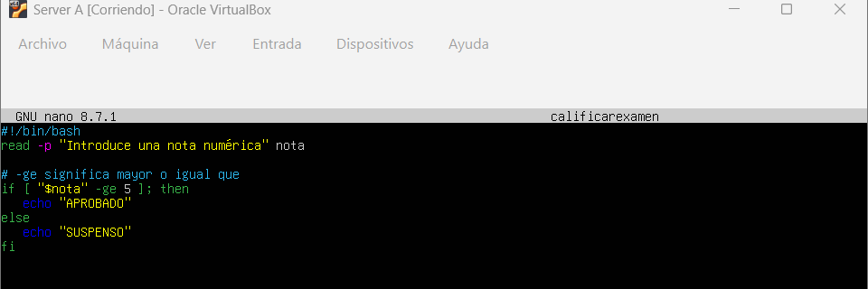
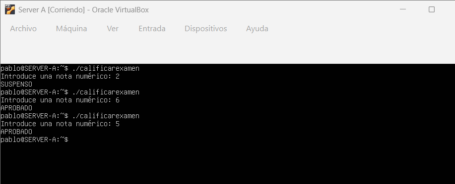

## 9. Menú de opciones
Script interactivo que despliega un menú en la terminal y ejecuta diferentes acciones (saludar, mostrar fecha o salir) dependiendo de la opción elegida, utilizando la estructura lógica `case`.

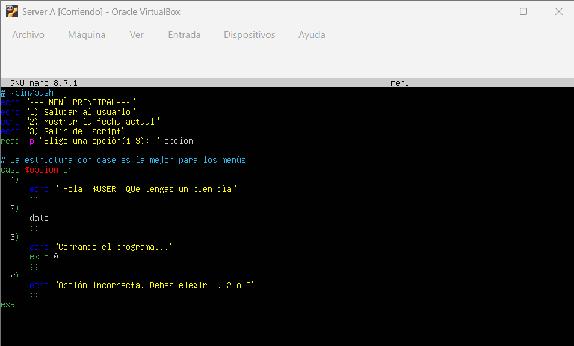
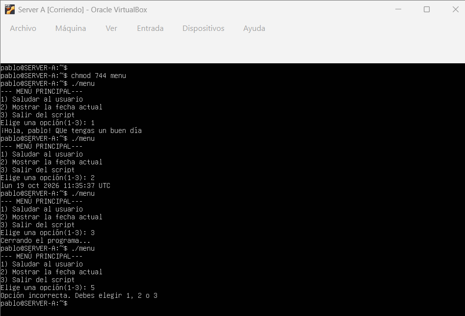

## 10. Evaluación de edad
Script de categorización que utiliza la estructura `if/elif/else` para clasificar al usuario según la edad introducida en tres rangos: menor de edad, adulto o mayor de 65 años.

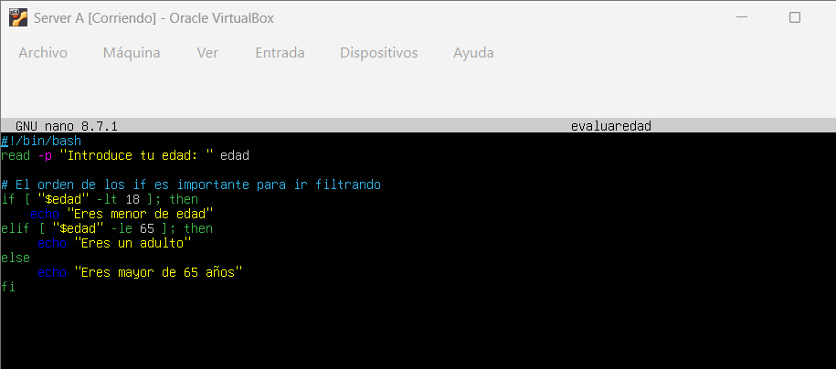
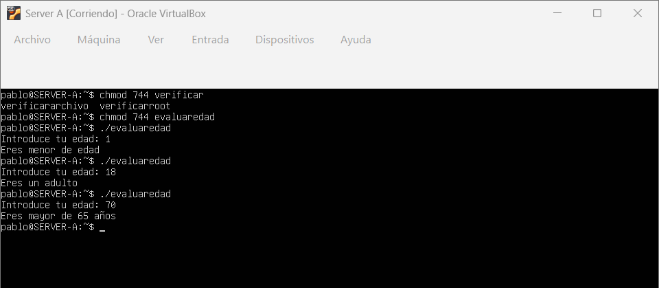