# Práctica PR0303: Scripts en Bash Avanzados

**Alumno:** Pablo González Coto

## 1. Calculadora básica
Script que funciona como una calculadora. Recibe dos números y una operación matemática por parámetros o los solicita por teclado, e incluye control de errores para evitar divisiones por cero.
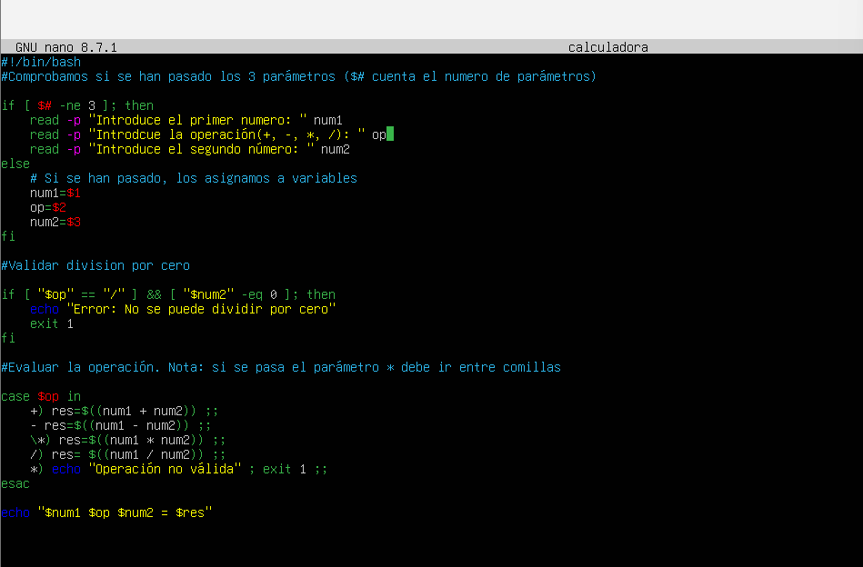
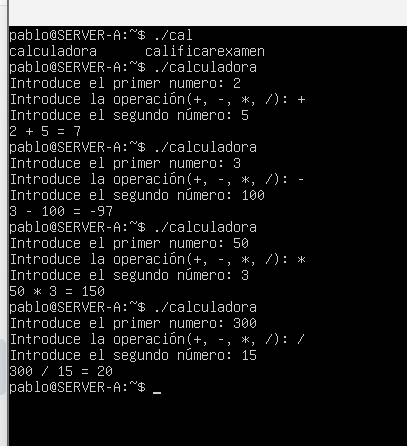

## 2. Validador de direcciones IP
Script que solicita una dirección IP y utiliza el comando `grep` con expresiones regulares extendidas (`-E`) para comprobar si el formato numérico introducido es válido.
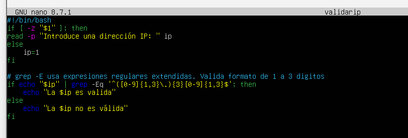
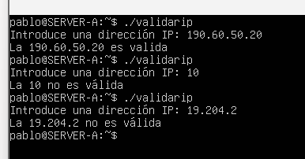

## 3. Contador de archivos por tipo
Script que busca en un directorio específico y utiliza la combinación de los comandos `find` y `grep -c` para contar cuántos archivos existen con las extensiones `.txt`, `.log` y `.sh`.
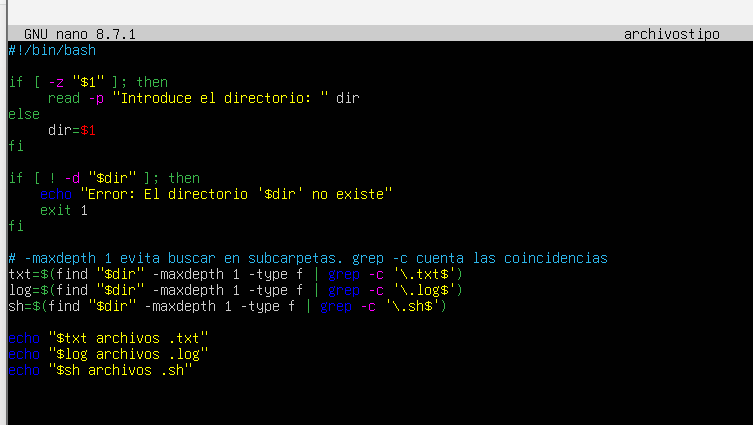
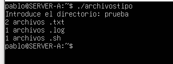

## 4. Backup de un directorio
Script que realiza una copia de seguridad comprimida (`tar.gz`) de un directorio de origen a uno de destino, nombrando el archivo resultante con la fecha actual en formato `YYYYMMDD`.
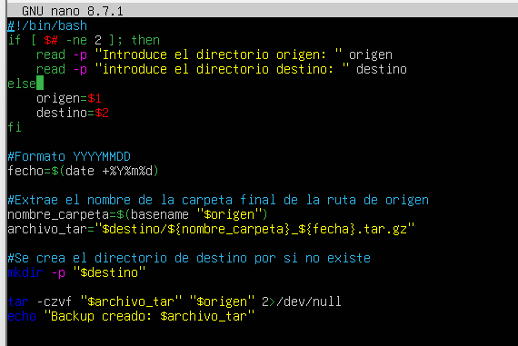
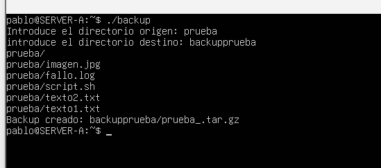

## 5. Conversor de temperatura (Celsius <-> Fahrenheit)
Script que solicita una temperatura y la unidad de origen (C o F). Empleando estructuras condicionales, aplica la fórmula matemática correspondiente para mostrar la conversión.
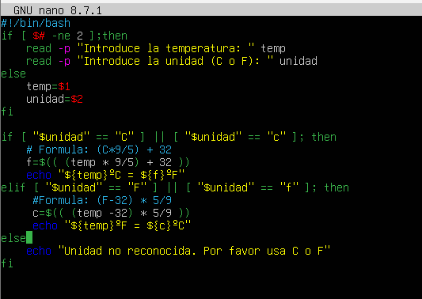
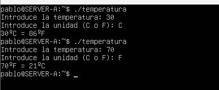

## 6. Generador de nombres de archivos aleatorios
Script que recibe una extensión y utiliza el dispositivo `/dev/urandom` junto con `tr`, `fold` y `head` para generar una cadena alfanumérica aleatoria única que servirá como nombre del archivo.
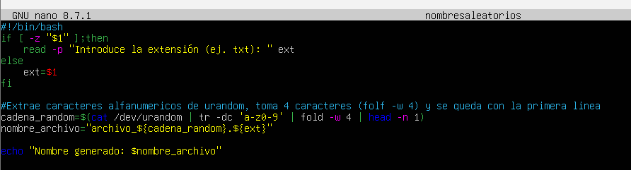
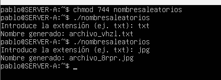

## 7. Script para comparar dos archivos
Script que verifica la existencia de dos ficheros de texto pasados por parámetro y utiliza el comando `diff` para comparar su contenido, mostrando por pantalla las líneas exactas en las que difieren.
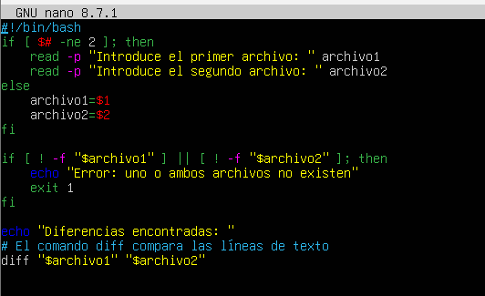
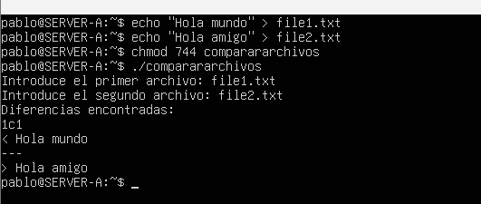

## 8. Generador de números aleatorios dentro de un rango
Script que solicita un valor numérico mínimo y uno máximo. Haciendo uso de la variable de entorno `$RANDOM` y aritmética de módulos, calcula y muestra un número aleatorio comprendido exactamente entre ambos límites.
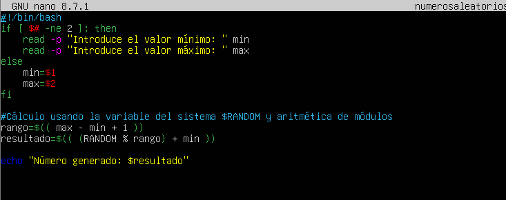
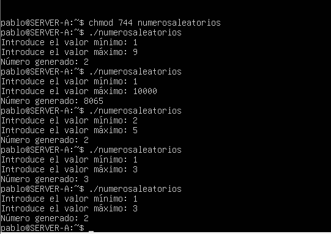