# Práctica PR0304: Comando case

**Alumno:** Pablo González Coto

## 1. Menú de operaciones matemáticas
Script que muestra un menú interactivo para sumar, restar, multiplicar o dividir dos números introducidos por el usuario, evaluando la opción elegida mediante `case`.

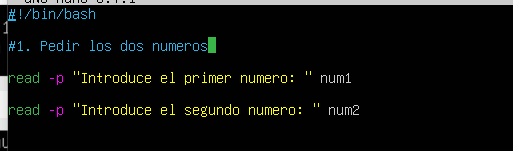

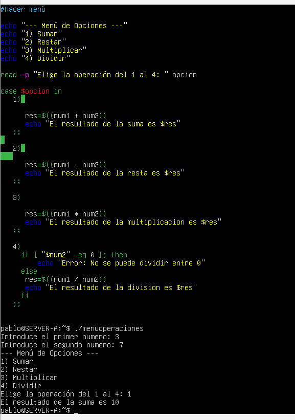

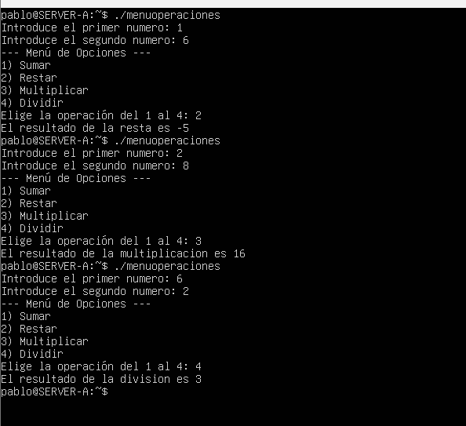

## 2. Verificar días de la semana
Script que solicita un día de la semana, lo convierte a minúsculas para evitar errores y determina mediante `case` si es un día laboral o fin de semana.

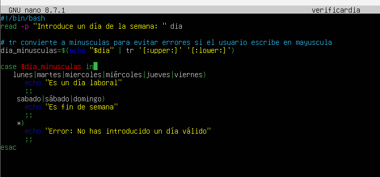

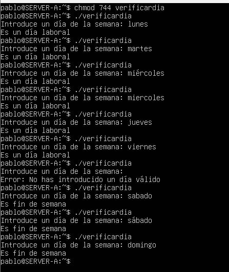

## 3. Clasificar calificaciones
Script que evalúa una nota numérica del 0 al 10 y utiliza `case` para clasificarla en Sobresaliente, Notable, Bien, Suficiente o Suspenso.

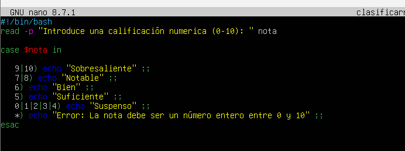

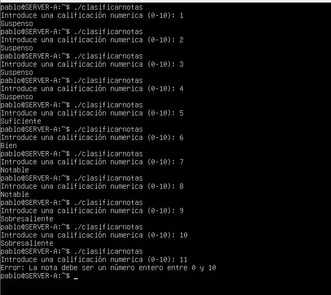

## 4. Determinar la estación del año
Script que asocia un mes del año introducido por el usuario con su estación correspondiente (primavera, verano, otoño o invierno) empleando la estructura `case`.

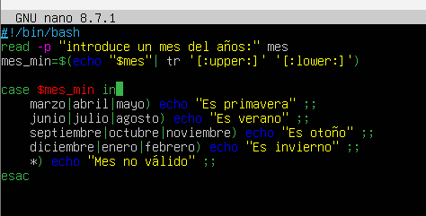

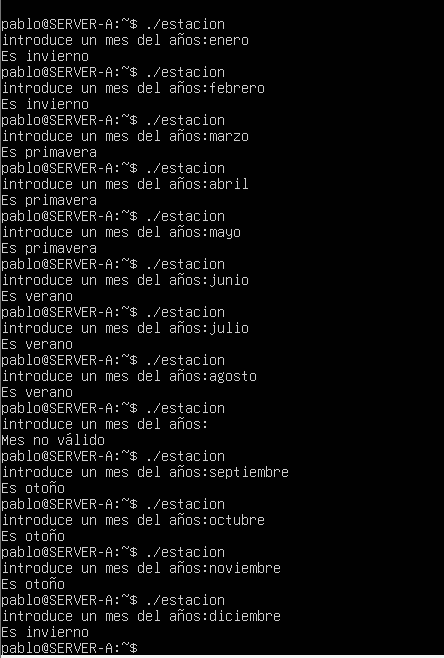

## 5. Identificar el tipo de archivo
Script que solicita la extensión de un archivo y muestra qué tipo de archivo es (texto, imagen, documento, etc.) utilizando la estructura `case`.

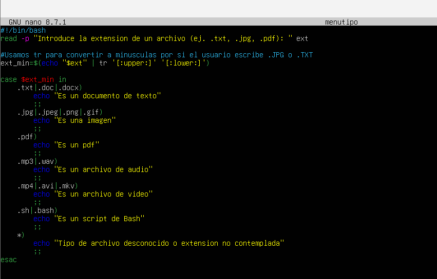

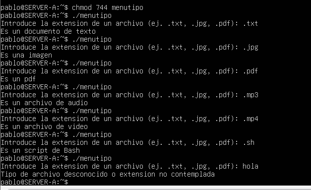

## 6. Convertir temperaturas
Script con un menú de opciones para convertir grados entre Celsius, Fahrenheit y Kelvin utilizando `case` y la calculadora `bc` para los decimales.

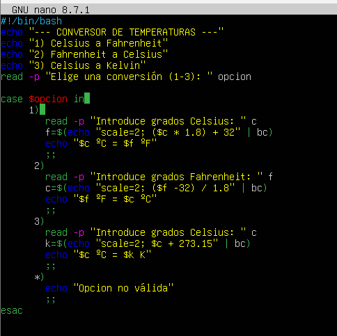

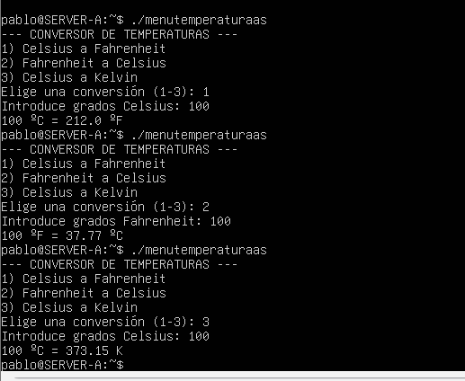

## 7. Estado del servicio
Script que recibe el nombre de un servicio del sistema y permite iniciarlo, detenerlo o reiniciarlo ejecutando comandos `systemctl` según la opción seleccionada.

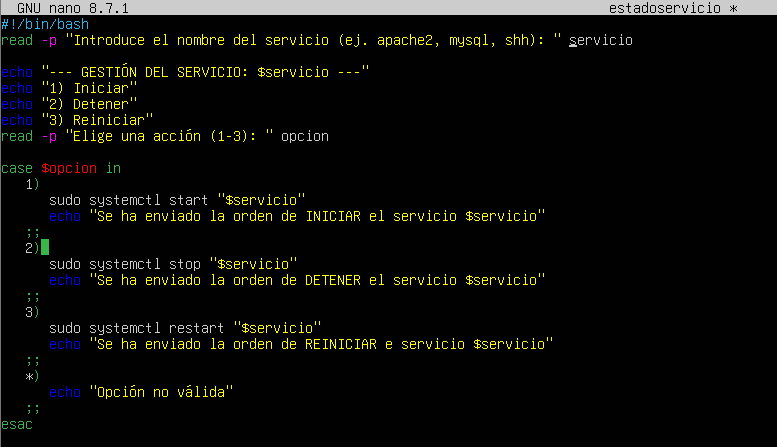

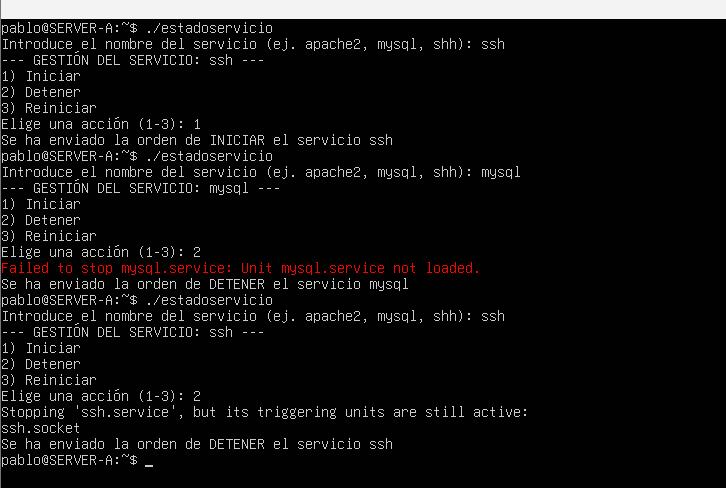

## 8. Conversión de unidades de longitud
Script que convierte una cantidad dada en metros a kilómetros, centímetros o milímetros, gestionando las distintas operaciones matemáticas con `case`.

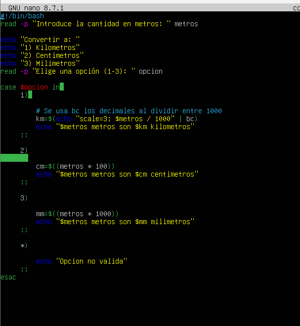

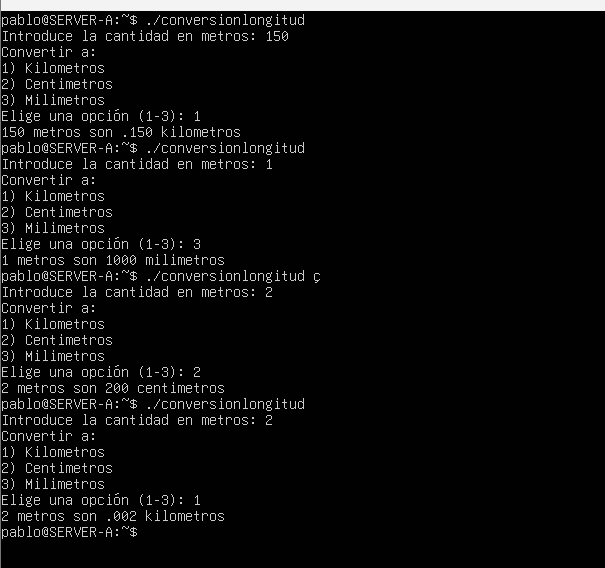