# Práctica PR0403: Manipulación de cadenas

**Alumno:** Pablo González Coto

## Ejercicio 1: Limpieza básica (mayúsculas, minúsculas y espacios)

### 1. Normalizar a mayúsculas
Transforma la cadena de entrada a mayúsculas utilizando el método `.ToUpper()`.

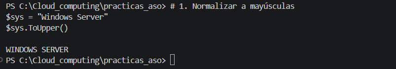

### 2. Normalizar a minúsculas
Transforma la cadena de entrada a minúsculas utilizando el método `.ToLower()`.

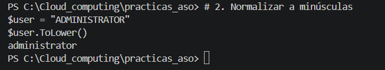

### 3. Limpieza de espacios extremos
Elimina los espacios en blanco al principio y al final de la cadena mediante el método `.Trim()`.

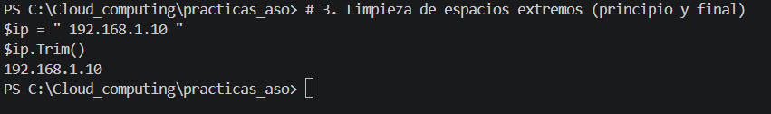

### 4. Eliminación total de espacios
Reemplaza todos los espacios de la cadena por una cadena vacía usando `.Replace(" ", "")`.

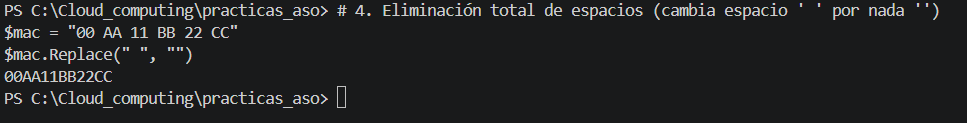

### 5. Longitud de la cadena
Obtiene el número total de caracteres de la cadena accediendo a su propiedad `.Length`.

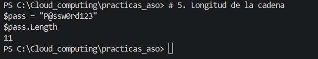

## Ejercicio 2: Reemplazo y sustitución

### 6. Cambio de separadores de fecha
Sustituye los puntos por guiones en la fecha utilizando `.Replace(".", "-")`.

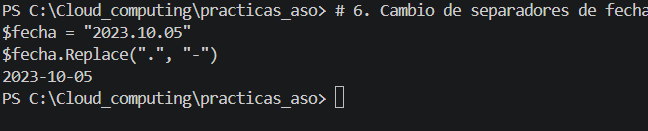

### 7. Actualización de dominio
Actualiza la extensión del dominio web sustituyendo ".es" por ".com" con el método `.Replace()`.

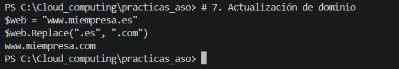

### 8. Censura de datos
Oculta el último bloque de una tarjeta de crédito dividiendo la cadena con `.Split("-")` y reemplazando el último segmento.

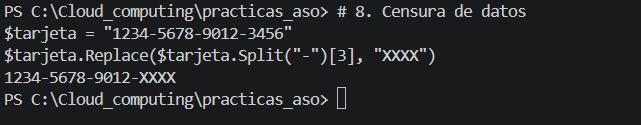

### 9. Cambio de barra de rutas (Linux a Windows)
Convierte una ruta de formato Linux a Windows reemplazando las barras `/` por contrabarras `\` empleando `.Replace()`.

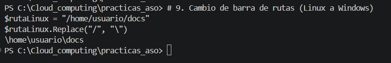

### 10. Doble reemplazo (limpiar prefijo y sufijo)
Elimina los paréntesis de apertura y cierre encadenando dos métodos `.Replace()` de forma consecutiva.

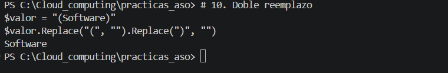

## Ejercicio 3: Extracción por posición

### 11. Extraer prefijo de país
Extrae el prefijo telefónico dividiendo la cadena por el guion y seleccionando el primer elemento con el índice `[0]`.

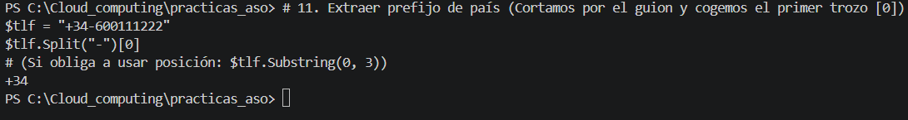

### 12. Extraer año fiscal (primeros 4 caracteres)
Extrae el año de un código dividiendo la cadena por el guion y tomando el primer elemento `[0]`.

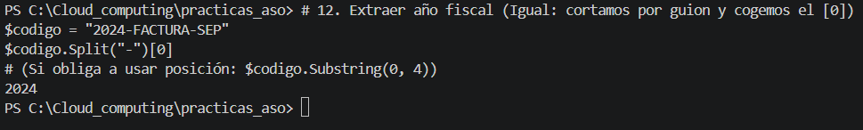

### 13. Ignorar el primer carácter
Omite la letra inicial de un identificador de empleado utilizando el método `.Substring(1)`.

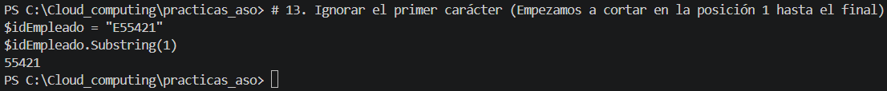

### 14. Extraer extensión de archivo (últimos 3)
Obtiene la extensión de un archivo dividiendo por el punto y seleccionando siempre el último elemento mediante el índice negativo `[-1]`.

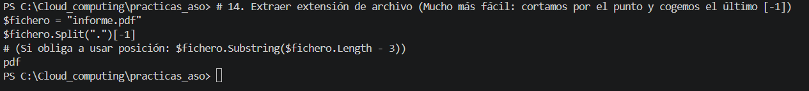

### 15. Relleno de ceros (Padding)
Añade ceros a la izquierda de un número hasta alcanzar una longitud total de 3 caracteres utilizando el método `.PadLeft(3, '0')`.

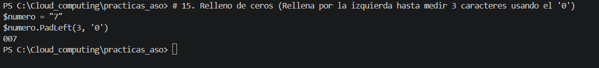

## Ejercicio 4: Troceado (Split) y arrays

### 16. Obtener nombre de usuario desde email
Extrae el nombre de usuario dividiendo la dirección de correo por la arroba y tomando el elemento `[0]`.

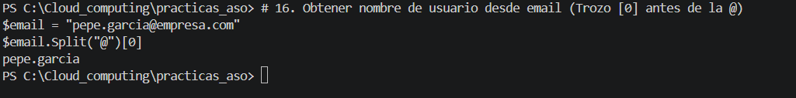

### 17. Obtener dominio desde email
Extrae el dominio dividiendo la dirección de correo por la arroba y seleccionando el elemento `[1]`.

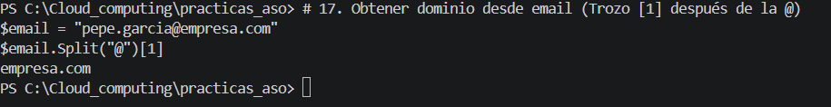

### 18. Obtener nombre de archivo de una ruta larga
Extrae el nombre del archivo al final de una ruta dividiendo por la contrabarra y seleccionando el último fragmento con `[-1]`.

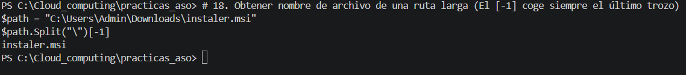

### 19. Obtener letra de unidad
Extrae la letra de la unidad de disco dividiendo la ruta por la contrabarra y seleccionando el primer fragmento `[0]`.

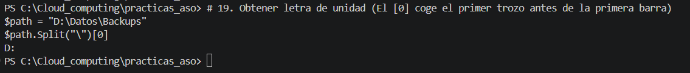

### 20. Separar CSV manual
Extrae el departamento dividiendo una línea en formato CSV manual por el punto y coma y seleccionando el índice `[1]`.

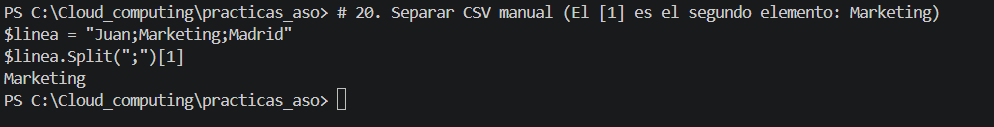

## Ejercicio 5: Aplicaciones prácticas

### 21. Detección de usuario Admin (Boolean)
Verifica si un nombre de usuario comienza con el prefijo "ADM" utilizando el método `.StartsWith()`.

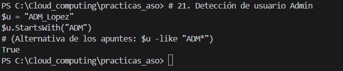

### 22. Formato de nombre propio
Convierte un nombre escrito en mayúsculas a formato propio: la inicial en mayúscula y el resto de letras en minúscula, combinando `.Substring()` y métodos de capitalización.

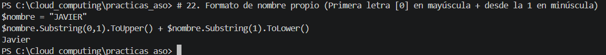

### 23. Limpieza de Distinguished Name (AD)
Extrae el nombre común (CN) de una cadena de Active Directory realizando un doble `.Split()`, primero por comas y después por signos de igual.

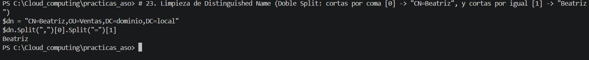

### 24. Generador de iniciales
Genera las iniciales formateadas a partir de dos variables combinando la indexación directa del primer carácter `[0]` de cada cadena.

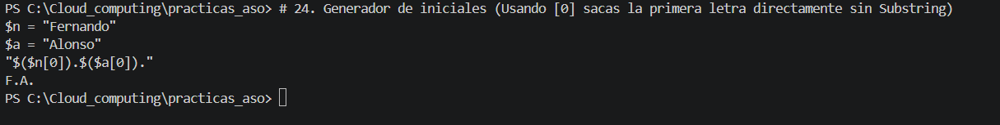

### 25. Inversión de fecha
Reorganiza una fecha en formato europeo a formato ISO (YYYYMMDD) sin guiones dividiendo la cadena e invirtiendo el orden de los fragmentos extraídos mediante sus índices.

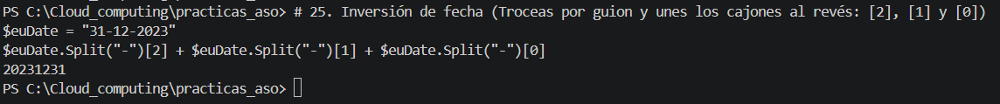