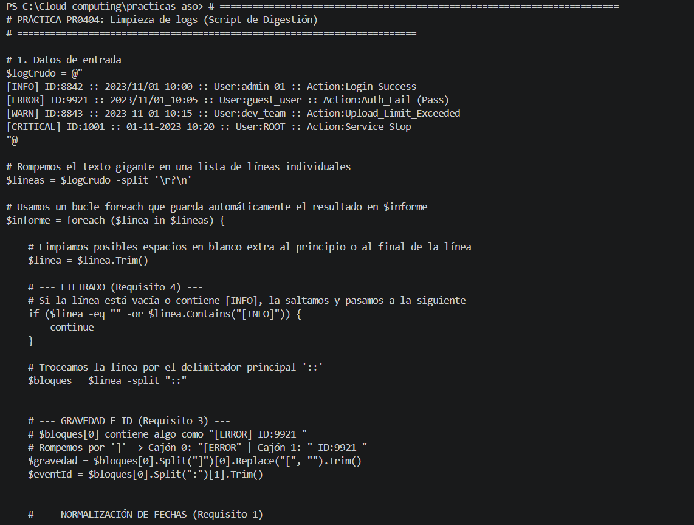
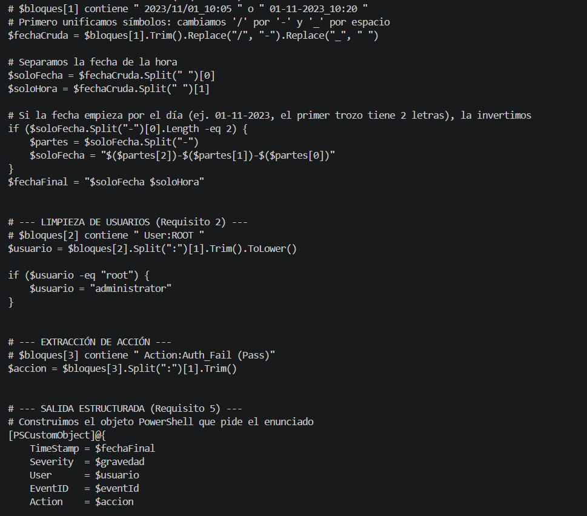
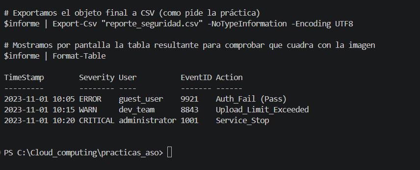

# Práctica PR0404: Limpieza de logs

**Alumno:** Pablo González Coto

## Script de Digestión de Logs
Script en PowerShell que procesa un bloque de texto crudo con logs poco estandarizados. El código realiza las siguientes acciones para transformar los datos en información estructurada:

1. **Filtrado:** Ignora las líneas vacías y los eventos informativos (`[INFO]`).
2. **Extracción:** Separa la gravedad del error (eliminando corchetes) y el ID del evento.
3. **Normalización de fechas:** Unifica los símbolos separadores (`/`, `_`) y reordena el formato `DD-MM-YYYY` al estándar ISO `YYYY-MM-DD`.
4. **Limpieza de usuarios:** Transforma los nombres a minúsculas y aplica una política de seguridad renombrando a "root" como "administrator".
5. **Salida estructurada:** Envuelve cada registro en un `[PSCustomObject]` y exporta el informe limpio a un archivo `reporte_seguridad.csv`.

