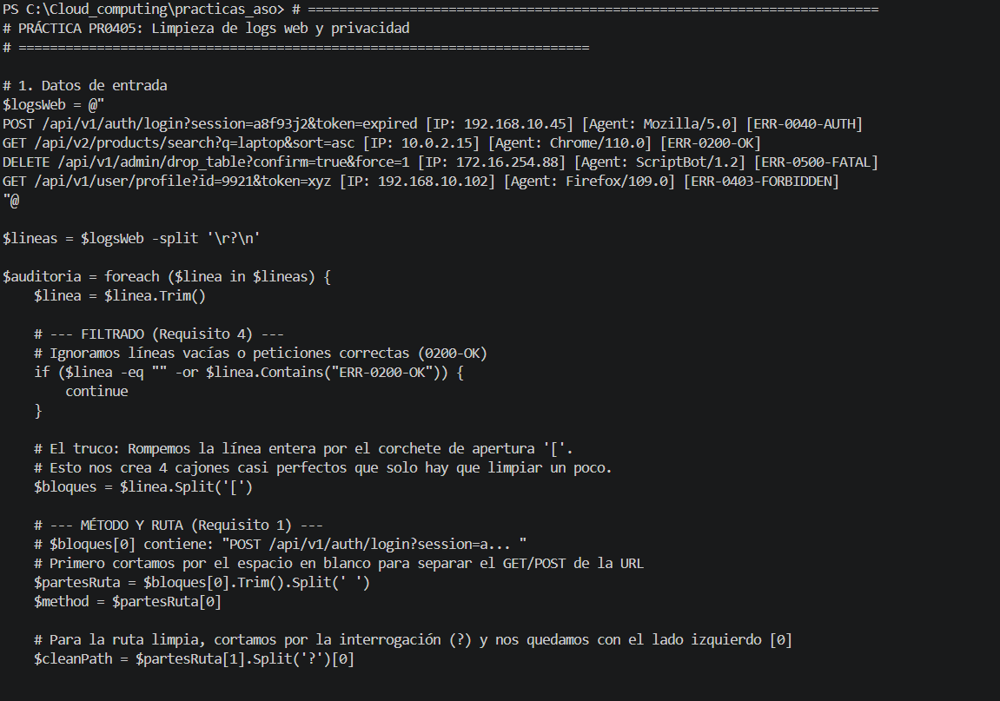
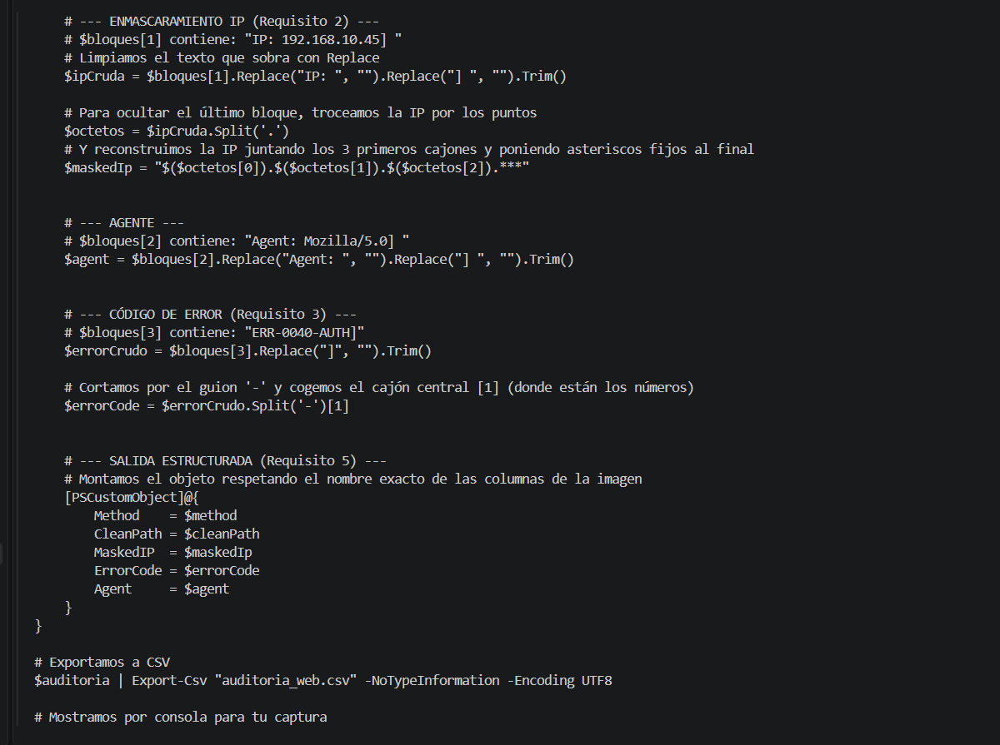
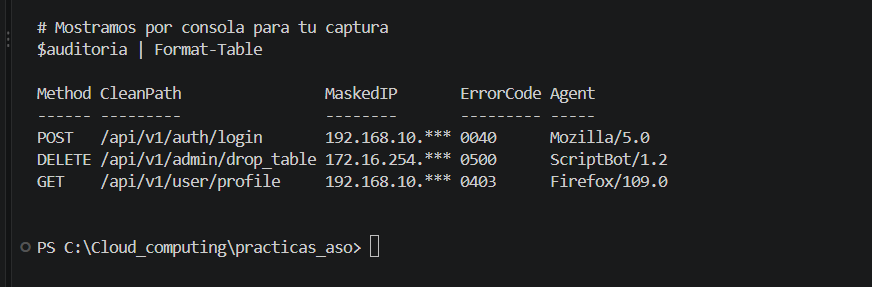

# Práctica PR0405: Limpieza de logs web y privacidad

**Alumno:** Pablo González Coto

## Script de Auditoría y Privacidad
Script en PowerShell que procesa un bloque de texto con logs web no estructurados. El código aplica diversas técnicas de manipulación de cadenas para extraer y limpiar datos clave, cumpliendo con normativas de privacidad y generando un informe auditable:

1. **Extracción y limpieza de ruta HTTP:** Separa el método HTTP y elimina los parámetros de consulta (a partir del `?`) para obtener rutas limpias.
2. **Filtrado de seguridad:** Ignora las peticiones correctas (código `0200-OK`) para centrarse exclusivamente en errores y bloqueos.
3. **Enmascaramiento de IP (GDPR):** Oculta el último octeto de cada dirección IP sustituyéndolo por asteriscos para preservar la privacidad.
4. **Procesamiento de errores:** Extrae el código numérico central de las cadenas de error complejas.
5. **Salida estructurada:** Crea un `[PSCustomObject]` con las columnas estandarizadas y exporta el resultado a un archivo `auditoria_web.csv`.

